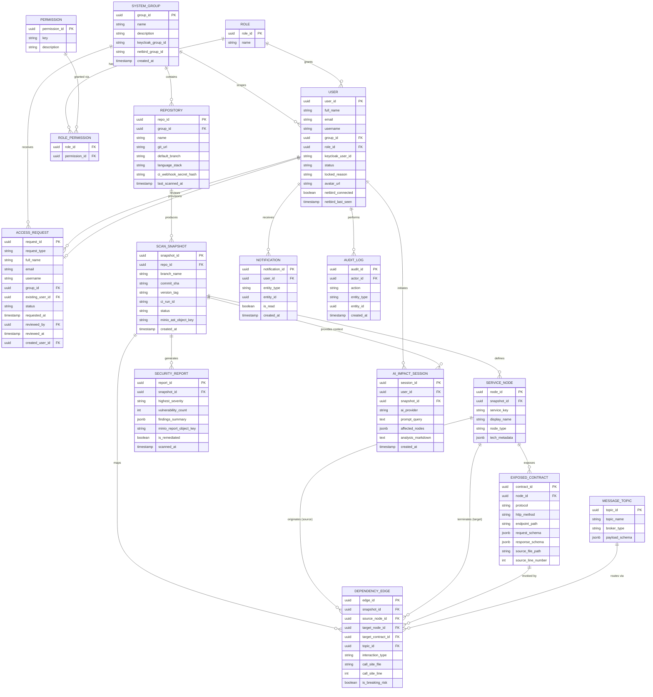

# Sơ đồ Quan hệ Thực thể (ERD) — Ứng dụng Bản đồ Kiến trúc Mã nguồn DevMapper

## Sơ đồ (Diagram)

Khối mã Mermaid dưới đây được **giữ nguyên bằng tiếng Anh** để tương thích tốt nhất với trình render trực tiếp của GitHub/GitLab mà không làm rối nhãn quan hệ. Do áp dụng kiến trúc Microservices, các bảng được phân chia theo từng Schema logic (xem chi tiết ở mục Thực thể bên dưới).

## Thực thể theo Schema (đề xuất, chờ `Opus Architect` chốt trong `PLAN.md`)

| Schema (service) | Bảng |
|---|---|
| `scanner_db` (`scanner-service`) | `REPOSITORY`, `SCAN_SNAPSHOT` |
| `topology_db` (`topology-service`) | `SERVICE_NODE`, `EXPOSED_CONTRACT`, `MESSAGE_TOPIC`, `DEPENDENCY_EDGE` |
| `ai_db` (`ai-mcp-service`) | `AI_IMPACT_SESSION` |
| `gov_db` (`quality-gov-service`) | `SYSTEM_GROUP`, `ROLE`, `PERMISSION`, `ROLE_PERMISSION`, `USER`, `ACCESS_REQUEST`, `AUDIT_LOG`, `NOTIFICATION`, `SECURITY_REPORT` |

**Quy tắc tham chiếu chéo:** các cột `group_id`, `snapshot_id`, `user_id`, `actor_id` trỏ sang schema khác chỉ là khóa logic (không tạo `FOREIGN KEY`, không `JOIN`); service sở hữu tự kiểm tra tồn tại qua REST/gRPC/Kafka. Chỉ các quan hệ nằm trong cùng schema mới có ràng buộc FK ở mức DB.

**Hạ tầng không phải thực thể** (đã loại khỏi sơ đồ): Keycloak (định danh qua `keycloak_user_id`, `keycloak_group_id`), NetBird (`netbird_group_id`, `netbird_connected`), MinIO (các cột `minio_*_key`), Kafka (sự kiện hoàn tất quét), Redis (cache đồ thị `global-graph`).
