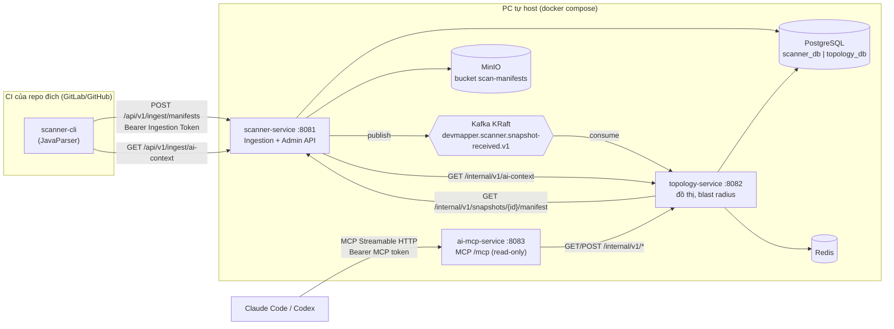

## **2026-11-03** -- Lịch sử prompt

1. Đánh giá bộ tài liệu markdown (PRD/SRS/ERD/AGENTS) theo đề bài "Architecture Mapping Automated System"; tạo bản `AGENTS.md` dùng model Claude cho Harness; kiểm tra Strix, Context7, Headroom, UI-UX-Pro-Max, Harness trên Claude CLI và cloud.
2. Cài các skill còn thiếu, dựng đội ngũ Harness và cập nhật các file markdown.

## **2026-11-03** -- Kế hoạch khởi tạo (NHÁP, chưa qua Cổng Xác nhận của Chủ dự án)

Đây chưa phải kế hoạch nghiên cứu chính thức của `Opus Architect`; chỉ là đề xuất thứ tự để `Opus Architect` chốt khi được gọi qua skill `devmapper-orchestrator`.

1. Hợp đồng trong `contracts/`: AST Manifest JSON Schema, OpenAPI cho Ingestion API.
2. Chốt phân bổ bảng theo schema (đề xuất ở `ERD.md`) và viết Flyway V1 cho từng schema.
3. MVP: `scanner-service` (nhận manifest, lưu MinIO) + `topology-service` (nối đồ thị, blast radius) + MCP read-only và `ai-architecture-context.json`.
4. Frontend React Flow cơ bản sau khi API đồ thị ổn định.
5. Hoãn: Keycloak/NetBird/Brevo đầy đủ, Architecture Diff, đa mô hình AI.

Mục cần Chủ dự án quyết định trước khi code: bảng 18 tiêu chí nào đánh dấu `N/A`.

## **2026-11-03** -- Kế hoạch MVP chính thức của Opus Architect (chờ Cổng Xác nhận)

Prompt nhận được: lập kế hoạch và hợp đồng giao tiếp cho MVP gồm `scanner-service`, `topology-service`, MCP read-only và `ai-architecture-context.json`; hoãn Keycloak/NetBird/Brevo đầy đủ, Architecture Diff, đa mô hình AI. Mục này thay thế bản nháp phía trên; chưa viết code ứng dụng.

### 1. Nguồn đã tra cứu (Context7)

Đã tra được:

- Spring Boot `v4.1.0`: Kafka dùng `JacksonJsonSerializer`/`JacksonJsonDeserializer` (Jackson 3), tắt type header bằng `spring.json.add.type.headers=false`; Flyway dùng `spring.flyway.*`, thiếu thuộc tính nào thì lấy từ `spring.datasource.*`.
- MyBatis Spring Boot Starter: nhánh `4.1.x` cho Spring Boot 4.1, Java 17+; cấu hình `mybatis.mapper-locations`, `mybatis.configuration.map-underscore-to-camel-case`.
- Flyway: mỗi schema có vòng đời riêng thì cấu hình `schemas` + `defaultSchema` + bảng lịch sử riêng; `createSchemas` tắt được.
- MCP Java SDK: `HttpServletStreamableServerTransportProvider` (có sẵn trong module `mcp` lõi, không cần Spring AI) đăng ký qua `ServletRegistrationBean` tại `/mcp`; `McpServer.sync(...)` + `SyncToolSpecification` + `CallToolResult`.
- JavaParser: `StaticJavaParser.parse(File)` trả `CompilationUnit`, mọi node có `getRange()` để lấy số dòng; hỗ trợ cú pháp Java 1.0 đến 25.

Chưa tra: Tree-sitter / `java-tree-sitter` (hoãn sang Phase 2, xem quyết định D4), MinIO Java SDK, Spring Kafka `DefaultErrorHandler` chi tiết (dùng theo kiến thức hiện có, `Sonnet Executor` phải tự tra Context7 lúc viết). Số phiên bản chính xác của JavaParser, MinIO SDK, MCP SDK phải được `Sonnet Executor` kiểm tra trên Maven Central khi khởi tạo `gradle/libs.versions.toml`.

### 2. Kiến trúc MVP



Cấu trúc thư mục (monorepo Gradle Kotlin DSL, client chưa làm ở MVP):

```text
settings.gradle.kts, build.gradle.kts, gradle.properties, gradle/libs.versions.toml, gradlew*
contracts/                       # hợp đồng (đã viết)
libs/devmapper-contracts/        # Java record của manifest, event, output tool; không logic
services/scanner-cli/            # CLI chạy trên CI, fat jar
services/scanner-service/        # Spring Boot, schema scanner_db
services/topology-service/       # Spring Boot, schema topology_db
services/ai-mcp-service/         # Spring Boot (servlet), không DB
infra/                           # docker-compose.yml, postgres/init.sql, .env.example
```

Gói Java mỗi service: `com.devmapper.<service>.{controller, service, mapper, model, dto, client, messaging, config}`. Luồng bắt buộc `Controller -> Service -> Mapper -> Model`. Kafka listener (`messaging`) đóng vai trò như Controller (chỉ gọi Service). Gọi ra ngoài (REST service khác, MinIO) đặt trong `client/` và chỉ Service được gọi. Mapper dùng XML trong `src/main/resources/mapper/`.

### 3. Quyết định kiến trúc

- **D1 — Phân bổ bảng theo schema (chốt, điều chỉnh so với ERD):**

| Schema | Bảng MVP | Ghi chú |
| :--- | :--- | :--- |
| `scanner_db` | `system_group`, `repository`, `scan_snapshot` | `SYSTEM_GROUP` chuyển từ `gov_db` sang đây vì FR-1 (đăng ký cụm polyrepo) thuộc scanner; FK `repository.group_id` nằm trong cùng schema |
| `topology_db` | `group_view`, `topology_snapshot`, `service_node`, `exposed_contract`, `message_topic`, `dependency_edge` | `group_view`, `topology_snapshot` là bản sao tối thiểu nhận từ sự kiện Kafka |
| `ai_db` | (trống ở MVP) | `AI_IMPACT_SESSION` làm ở Phase 3 |
| `gov_db` | (trống ở MVP) | Phase 2: `ROLE`, `PERMISSION`, `ROLE_PERMISSION`, `USER`, `ACCESS_REQUEST`, `AUDIT_LOG`, `NOTIFICATION`, `TEST_TRACE_ARTIFACT`, `SECURITY_REPORT` và bảng mới `group_binding(group_id, keycloak_group_id, netbird_group_id)` thay cho 2 cột này trên `SYSTEM_GROUP` |

Cột chi tiết và chỉ mục:

- `scanner_db.system_group(group_id uuid PK, name varchar(100) UNIQUE, description, created_at)`.
- `scanner_db.repository(repo_id PK, group_id FK, name, git_url UNIQUE, default_branch, language_stack, ingestion_token_hash char(64) UNIQUE, token_rotated_at, last_scanned_at, created_at)`; `UNIQUE(group_id, name)`. Cột `ci_webhook_secret_hash` của ERD đổi tên thành `ingestion_token_hash`.
- `scanner_db.scan_snapshot(snapshot_id PK, repo_id FK, branch_name, commit_sha, version_tag, ci_run_id, status, minio_ast_object_key, manifest_sha256, manifest_size_bytes, scanner_version, warnings_count, created_at, published_at)`; `UNIQUE(repo_id, commit_sha, branch_name)`, index `(repo_id, created_at DESC, snapshot_id)`, partial index `(created_at) WHERE status='RECEIVED'`.
- `topology_db.group_view(group_id PK, group_name UNIQUE, graph_version bigint, updated_at)`.
- `topology_db.topology_snapshot(snapshot_id PK, group_id, repo_id, repo_name, branch_name, commit_sha, received_at, is_head bool, ingested_at)`; partial unique `(repo_id) WHERE is_head`, partial index `(group_id) WHERE is_head`.
- `topology_db.service_node(node_id PK, snapshot_id FK ON DELETE CASCADE, group_id, service_key, display_name, node_type, tech_metadata jsonb)`; `UNIQUE(snapshot_id, service_key)`, index `(group_id, service_key)`.
- `topology_db.exposed_contract(contract_id PK, node_id FK CASCADE, protocol, http_method, endpoint_path, path_pattern, grpc_method, request_schema jsonb, response_schema jsonb, source_file_path, source_line_number)`; index `(node_id)`, `(protocol, http_method, path_pattern)`.
- `topology_db.message_topic(topic_id PK, group_id, broker_type, topic_name, payload_schema jsonb)`; `UNIQUE(group_id, broker_type, topic_name)`.
- `topology_db.dependency_edge(edge_id PK, snapshot_id FK CASCADE, source_node_id FK CASCADE, interaction_type, target_service_hint, target_http_method, target_path_pattern, target_grpc_method, target_resource, target_node_id FK SET NULL, target_contract_id FK SET NULL, topic_id FK, call_site_file, call_site_line, resolution_status, is_breaking_risk, resolution_source)`; index `(snapshot_id)`, `(source_node_id)`, `(target_node_id)`, `(target_contract_id)`, `(topic_id, interaction_type)`, `(target_service_hint, target_http_method, target_path_pattern)`.
- `snapshot_id`, `group_id`, `repo_id` trong `topology_db` là khóa logic sang `scanner_db`: không FK, không JOIN xuyên schema. FK chỉ trong cùng schema như trên.

- **D2 — Cô lập schema ở mức DB:** `infra/postgres/init.sql` tạo 4 schema và role riêng `scanner_svc`, `topology_svc` (MVP chỉ 2 role), mỗi role chỉ có quyền trên schema của mình (`REVOKE ALL ON SCHEMA public`). JDBC URL đặt `currentSchema=<schema>`; Flyway mỗi service: `spring.flyway.schemas=<schema>`, `default-schema=<schema>`, `create-schemas=false`, bảng lịch sử nằm trong schema của service. Vi phạm xuyên schema sẽ lỗi quyền ngay khi chạy.
- **D3 — Luồng nạp:** CI chỉ gọi HTTPS Ingestion API. scanner-service: xác thực token → validate (Bean Validation trên record của `libs/devmapper-contracts` + đối chiếu `repo.git_url`) → tính SHA-256 → ghi MinIO `manifests/{repo_id}/{snapshot_id}.json` → insert `scan_snapshot` (`RECEIVED`) → publish Kafka → `PUBLISHED`. Outbox tối giản: job 60s phát lại snapshot `RECEIVED` (xem `contracts/kafka-events.md`). topology-service KHÔNG đọc MinIO mà gọi REST nội bộ của scanner để giữ MinIO thuộc riêng scanner.
- **D4 — Scanner CLI MVP chỉ hỗ trợ Java/Spring bằng JavaParser** (`@RestController`, `@RequestMapping`/`@GetMapping`..., `@FeignClient`, `RestClient`/`RestTemplate`/`WebClient` với URI literal, `@KafkaListener`, `KafkaTemplate.send("literal")`, nội suy `${...}` từ `application.yml/properties`, `spring.datasource.url` → `DB_ACCESS`). Tree-sitter đa ngôn ngữ, Axios, gRPC (`.proto`), OpenAPI/AsyncAPI để Phase 2; schema manifest đã chừa sẵn `GRPC`, `typescript`... nên không phải đổi hợp đồng.
- **D5 — Nối đồ thị (stitching):** đồ thị hiện hành của group = head (snapshot mới nhất của nhánh mặc định) của mỗi repo. Đường dẫn chuẩn hóa `path_pattern` (biến `{x}`/`:x` → `{}`, bỏ `/` cuối). Sau mỗi lần nạp, chạy 1 câu `UPDATE dependency_edge ... FROM service_node, exposed_contract` cho toàn bộ cạnh của head trong group: khớp `target_service_hint = service_key` và `(http_method, path_pattern)`; không có hint thì khớp duy nhất theo `(method, path_pattern)` trong group. Cạnh Kafka nối qua `message_topic`. Cạnh từng `RESOLVED` mà nay không khớp → `UNRESOLVED` + `is_breaking_risk=true`. Không lặp gọi DB theo cạnh.
- **D6 — Blast radius:** `WITH RECURSIVE` trên head snapshots trong `topology_db`, chống vòng bằng mảng path, `max_depth` ≤ 5, ngữ nghĩa ở `contracts/mcp-tools.md`.
- **D7 — Cache:** Redis, khóa `topo:{group_id}:{graph_version}:{hash(params)}`, TTL 1 giờ. Mỗi lần nạp tăng `graph_version` nên khóa cũ tự vô hiệu (không cần xóa thủ công). ETag `"g<graph_version>"`.
- **D8 — Xác thực MVP (không Keycloak):** Ingestion Token mỗi repo (`dmi_` + 32 byte ngẫu nhiên base64url, lưu SHA-256, so sánh constant-time); `DEVMAPPER_ADMIN_TOKEN` cho admin API; `DEVMAPPER_INTERNAL_TOKEN` (header `X-Internal-Token`) giữa các service; `DEVMAPPER_MCP_TOKEN` cho `/mcp`. Cài đặt bằng 1 `OncePerRequestFilter` mỗi service, chưa dùng Spring Security (thêm ở Phase 2 cùng Keycloak). Reverse proxy chỉ mở `/api/v1/ingest/**`.
- **D9 — Hoãn API Gateway** sang Phase 2 (đi cùng Keycloak/JWT). MVP chỉ có 3 service, routing do Traefik/compose port; thêm Gateway lúc này chỉ là một hop không có việc.
- **D10 — `ai-architecture-context.json`:** topology-service sinh; scanner-service proxy qua `GET /api/v1/ingest/ai-context` (chỉ 1 bề mặt công khai, tái dùng Ingestion Token, scope = group của repo); `scanner-cli export-context` ghi file cho CI làm artifact.
- **D11 — Stack:** Java 21 LTS, Spring Boot 4.1.x, MyBatis starter 4.1.x, Flyway và spring-kafka theo BOM của Boot, MCP Java SDK lõi, JavaParser, MinIO Java SDK, PostgreSQL 17, Redis 7, Kafka KRaft (apache/kafka), MinIO. `libs/devmapper-contracts` là module dùng chung duy nhất (dùng bởi scanner-cli, scanner-service, topology-service, ai-mcp-service: ≥ 3 nơi theo quy tắc 2.2), chỉ chứa record + enum.
- **D12 — Kafka không xác thực ở MVP** (chỉ trong mạng docker, không publish port ra ngoài host trừ `localhost` khi dev). SASL để Phase 2.

### 4. Danh sách module cho Sonnet Executor

| # | Module | Thư mục được phép sửa | Phụ thuộc | Effort | Đầu ra chính |
| :--- | :--- | :--- | :--- | :--- | :--- |
| M0 | Nền tảng build + hợp đồng Java + hạ tầng | gốc (`settings.gradle.kts`, `build.gradle.kts`, `gradle.properties`, `gradle/`, `gradlew*`), `libs/devmapper-contracts/`, `infra/` | — | high | Gradle multi-project (build cache, configuration cache, parallel), version catalog, record cho manifest/event/tool output, test hợp đồng: `contracts/examples/ast-manifest.example.json` validate đúng schema (thư viện json-schema chỉ ở `testImplementation`) và deserialize vào record; `infra/docker-compose.yml` (postgres, redis, kafka KRaft, minio, có `mem_limit`), `infra/postgres/init.sql` (D2), `infra/.env.example` chỉ tên biến, không giá trị |
| M1 | `scanner-cli` | `services/scanner-cli/` | M0 | high | Lệnh `scan --repo-root --out`, `push --manifest --api-url` (token đọc từ env `DEVMAPPER_INGESTION_TOKEN`), `export-context --api-url --out [--service-key --depth]`; parse tham số tay (không picocli), `java.net.http.HttpClient`, Jackson + jackson-dataformat-yaml; fixture repo Spring mẫu trong `src/test/resources` |
| M2 | `scanner-service` | `services/scanner-service/` | M0 | high | Flyway `V1__scanner_init.sql`; Ingestion/Admin/Internal API theo `contracts/ingestion-api.openapi.yaml`; MinIO client; Kafka producer + job phát lại; phân trang cursor `(created_at, id)`; ProblemDetail |
| M3 | `topology-service` | `services/topology-service/` | M0 | xhigh | Flyway `V1__topology_init.sql`; Kafka consumer + DLT; client gọi manifest; batch insert (MyBatis `foreach`); stitching D5; blast radius D6; endpoint `/internal/v1/*` theo `contracts/mcp-tools.md`; Redis cache D7; ETag |
| M4 | `ai-mcp-service` | `services/ai-mcp-service/` | M0 (hợp đồng endpoint nội bộ của M3, không cần M3 chạy) | high | MCP server sync tại `/mcp`, 3 tool, filter token, client `RestClient` tới topology; test bằng mock server (`MockRestServiceServer`) |

Thứ tự: M0 chạy trước một mình (các module khác phụ thuộc build gốc và record). Sau khi M0 qua test, M1–M4 chạy song song, mỗi module một worktree. Không module nào sửa thư mục của module khác; cần đổi hợp đồng → dừng, báo Tier 2.

### 5. Phương án 18 tiêu chí (AGENTS.md 2.3)

| # | Tiêu chí | Phương án MVP |
| :--- | :--- | :--- |
| 1 | Server-side caching | Redis cho kết quả đồ thị/blast radius/ai-context (D7). Kết quả tra token không cache (luôn qua index unique). |
| 2 | Cache API responses | ETag `"g<graph_version>"` + `Cache-Control: no-cache` + 304 cho mọi GET đồ thị ở topology và `/api/v1/ingest/ai-context`. Phần TanStack Query: N/A ở MVP vì chưa có client. |
| 3 | Compress payloads | `server.compression.enabled=true` (mime `application/json,application/problem+json`, `min-response-size=2KB`) ở cả 3 service; khi có Traefik thì bật middleware `compress`. |
| 4 | Load balancer | Áp dụng một phần: service phi trạng thái (không session, state ở Postgres/Redis/Kafka), Actuator `/actuator/health/liveness` và `/readiness` (readiness gồm db, redis, kafka). Cân bằng tải nhiều instance: N/A vì chạy 1 instance trên 1 PC. |
| 5 | CDN | N/A: công cụ nội bộ trên 1 PC sau VPN, MVP chưa có tài nguyên tĩnh. |
| 6 | Index DB | Toàn bộ index liệt kê ở D1, nằm trong migration V1. JSONB chỉ được trả ra, không lọc nên chưa cần GIN. |
| 7 | Cache expensive queries | Blast radius `WITH RECURSIVE` và tổng hợp đồ thị đi qua cache D7; invalidation bằng `graph_version`. |
| 8 | N+1 | Batch insert node/contract/topic/edge bằng `foreach` (chia lô 500); stitching bằng 1 câu `UPDATE ... FROM`; đọc đồ thị bằng JOIN trong cùng `topology_db` hoặc `WHERE IN`; mỗi tool MCP gọi đúng 1 endpoint. Cấm gọi Mapper/REST trong vòng lặp. |
| 9 | Connection pool | HikariCP: scanner `maximum-pool-size=5`, topology `8`, `minimum-idle=1`, `idle-timeout=300000`, `connection-timeout=5000`, `max-lifetime=1800000`; Postgres `max_connections=50`. ai-mcp-service không có DB. Redis Lettuce dùng chung 1 kết nối mặc định. |
| 10 | Phân trang | Admin list dùng cursor (`limit` mặc định 50, tối đa 200). Tool/endpoint đồ thị có `limit` (mặc định 100, tối đa 500) + `truncated`. Không endpoint nào trả toàn bảng. Virtualization UI: N/A (chưa có client). |
| 11 | Code splitting | N/A: MVP không có frontend. |
| 12 | Lazy loading | N/A: MVP không có frontend. (Phía server: `spring.main.lazy-initialization` không bật vì làm chậm phát hiện lỗi cấu hình.) |
| 13 | Re-render | N/A: MVP không có frontend. |
| 14 | Debounce | N/A: MVP không có frontend. |
| 15 | Minify JS/CSS | N/A: MVP không có frontend. |
| 16 | Defer scripts | N/A: MVP không có frontend. |
| 17 | Unused dependencies | Mỗi module tự rà `build.gradle.kts` trước khi báo xong; M0 thêm plugin `com.autonomousapps.dependency-analysis` ở root, chạy `./gradlew buildHealth` trong bước lint. |
| 18 | Lighthouse | N/A: MVP không có giao diện web. |

### 6. Chiến lược kiểm thử MVP

- Mỗi module chạy `./gradlew :<path>:check` (unit test + `buildHealth` cho module đó). E2E Playwright và Lighthouse: chưa cần ở MVP (không có UI).
- M0: test hợp đồng (example manifest hợp lệ theo schema; vài manifest sai bị loại: `..` trong path, thiếu `service_key`, sai `commit_sha`).
- M1: test parser trên repo fixture (controller, FeignClient, KafkaListener, KafkaTemplate, placeholder `${...}`, URL động sinh `warnings`); output validate theo schema.
- M2: unit test Service (token hash, idempotent, sai repo → 403); test Mapper và Flyway bằng Testcontainers PostgreSQL; MinIO/Kafka mock ở unit, Testcontainers Kafka cho 1 test tích hợp publish.
- M3: test Mapper + migration bằng Testcontainers PostgreSQL; test stitching (khớp có hint, không hint, mất contract → `is_breaking_risk`), blast radius (nhiều tầng, vòng lặp, `max_depth`), consumer idempotent (event trùng), sha256 lệch → DLT.
- M4: test 3 tool với `MockRestServiceServer`, kiểm tra `isError` khi 404, token sai → 401.
- Testcontainers cần Docker Desktop đang chạy. Sau khi M1–M4 qua: một kịch bản smoke thủ công trong `markdown/TESTING.md` (compose up → đăng ký repo → `scanner-cli scan/push` trên fixture → gọi tool MCP).
- Sau `[REVIEW_PASSED]`: `/claude-security scan changes` (effort high).

### 7. Rủi ro

- Gradle chưa có trên PATH nên không sinh được Gradle wrapper; M0 cần Gradle cài một lần (hoặc cho phép tải bản phân phối Gradle).
- Docker Desktop chưa chạy: Testcontainers và compose không chạy được.
- Phân tích tĩnh bỏ sót URL động (PRD mục 8): đánh dấu `resolution=DYNAMIC` và đưa vào `warnings`, cạnh không nối được hiện ở `unresolved_edges` thay vì bị bỏ.
- Ngữ nghĩa blast radius tầng ≥ 2 là xấp xỉ theo service (dương tính giả), đã ghi rõ trong hợp đồng tool.
- Bảng `topology_db` tăng theo số lần quét vì giữ mọi snapshot (để làm Architecture Diff sau này); dọn dữ liệu (retention) để Phase 2.
- Bảo mật MVP dựa vào token tĩnh trong env; lộ `DEVMAPPER_ADMIN_TOKEN` là lộ quyền cấp token. Giảm thiểu: admin API không mở qua reverse proxy; thay bằng Keycloak ở Phase 2.
- Ghi audit (FR-6) cho thao tác admin chưa có vì `gov_db` hoãn; Phase 2 phát sự kiện audit từ scanner sang `quality-gov-service`.

### 8. Câu hỏi mở cần Chủ dự án xác nhận

1. Trong MVP (chưa có NetBird/Traefik), CI sẽ gọi Ingestion API bằng cách nào: runner tự host trên chính PC (gọi `localhost`) hay runner GitLab bên ngoài (cần mở một đường HTTPS công khai chỉ cho `/api/v1/ingest/**`)?
2. Đồng ý chuyển `SYSTEM_GROUP` sang `scanner_db`, tách `keycloak_group_id`/`netbird_group_id` sang `gov_db.group_binding` ở Phase 2 (D1)?
3. Đồng ý scanner CLI MVP chỉ quét Java/Spring bằng JavaParser, hoãn Tree-sitter/Axios/gRPC/OpenAPI (D4)?
4. Đồng ý hoãn API Gateway sang Phase 2 (D9)?
5. Đồng ý Java 21 + Spring Boot 4.1.x (D11)?
6. Duyệt danh sách N/A: tiêu chí 5, 11–16, 18 (N/A), tiêu chí 2, 4, 10 áp dụng một phần (mục 5).
7. Cài Gradle một lần để sinh wrapper, hay cho phép `Sonnet Executor` tải bản phân phối Gradle?

### 9. Biến môi trường / secret Chủ dự án tự cấu hình

Chỉ liệt kê tên, không có giá trị mặc định. Tất cả đặt trong `infra/.env` (đã cần thêm vào `.gitignore`) hoặc secret của CI.

| Tên | Dùng ở |
| :--- | :--- |
| `POSTGRES_PASSWORD` | container PostgreSQL (superuser, chỉ để init) |
| `SCANNER_DB_PASSWORD` | role `scanner_svc`, scanner-service |
| `TOPOLOGY_DB_PASSWORD` | role `topology_svc`, topology-service |
| `REDIS_PASSWORD` | Redis, topology-service |
| `MINIO_ROOT_USER`, `MINIO_ROOT_PASSWORD` | container MinIO |
| `SCANNER_MINIO_ACCESS_KEY`, `SCANNER_MINIO_SECRET_KEY` | scanner-service (user MinIO riêng, chỉ quyền bucket `scan-manifests`) |
| `DEVMAPPER_ADMIN_TOKEN` | scanner-service admin API |
| `DEVMAPPER_INTERNAL_TOKEN` | scanner-service, topology-service, ai-mcp-service |
| `DEVMAPPER_MCP_TOKEN` | ai-mcp-service và `.mcp.json` của người dùng |
| `DEVMAPPER_INGESTION_TOKEN`, `DEVMAPPER_API_URL` | secret/biến CI của từng repo đích (token lấy từ admin API, mỗi repo một token) |

Biến không nhạy cảm (có giá trị mặc định trong `application.yml`, không cần hỏi): `KAFKA_BOOTSTRAP_SERVERS`, `DB_HOST`, `REDIS_HOST`, `MINIO_ENDPOINT`, `SCANNER_BASE_URL`, `TOPOLOGY_BASE_URL`.

### 10. Hợp đồng đã viết

- `contracts/ast-manifest.schema.json` (+ ví dụ `contracts/examples/ast-manifest.example.json`)
- `contracts/ingestion-api.openapi.yaml` (ingest, admin, internal của scanner-service)
- `contracts/mcp-tools.md` (3 tool, định dạng `ai-architecture-context.json`, endpoint nội bộ của topology-service)
- `contracts/kafka-events.md` (`devmapper.scanner.snapshot-received.v1`)

## **2026-11-03** -- Phản hồi của Chủ dự án tại Cổng Xác nhận (CHƯA phê duyệt kế hoạch)

Chủ dự án chọn "chưa phê duyệt": kế hoạch ở mục trước vẫn ở trạng thái chờ, không viết code.

Đã trả lời các câu hỏi mở:

- Câu 1 (CI gọi Ingestion API): dùng runner tự host trên chính PC, gọi `localhost`; không mở đường HTTPS công khai trong MVP.
- Câu 7 (Gradle): Chủ dự án tự cài Gradle một lần để sinh wrapper; Docker Desktop vẫn phải chạy cho Testcontainers.
- Thời điểm cấu hình secret: thiết lập ngay bây giờ, do Chủ dự án tự chạy script sinh `infra/.env` (giá trị ngẫu nhiên, không in ra). Chưa sinh `DEVMAPPER_INGESTION_TOKEN` (cấp từng repo qua admin API) và `DEVMAPPER_API_URL`.

Các câu 2–6 (D1 `SYSTEM_GROUP`, D4 phạm vi CLI, D9 API Gateway, D11 phiên bản, danh sách N/A) chưa được trả lời riêng.
